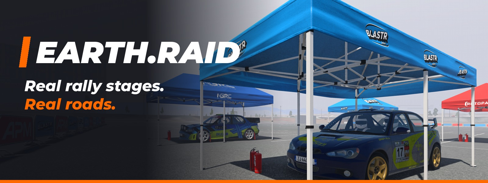
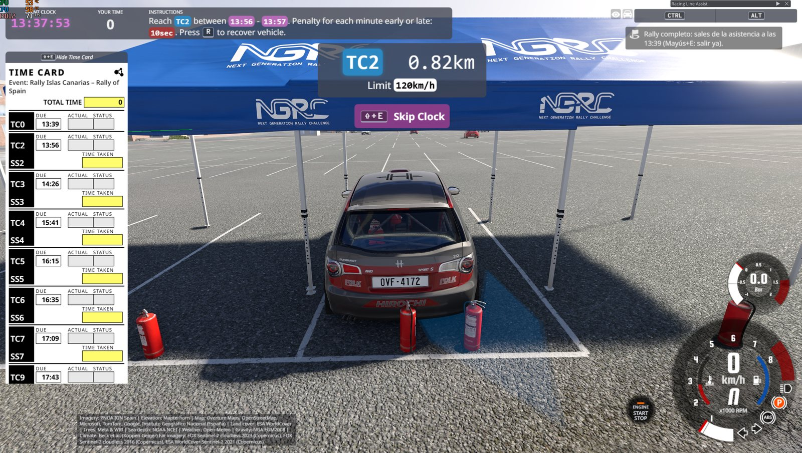
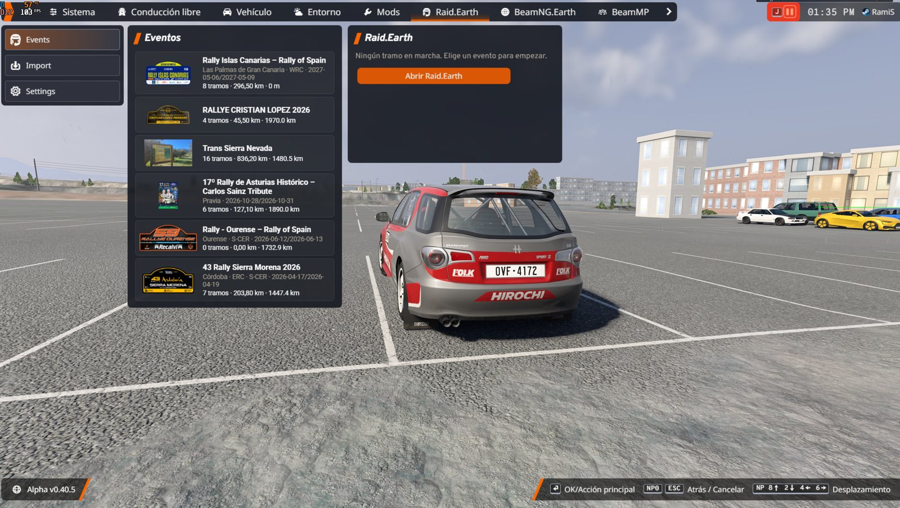
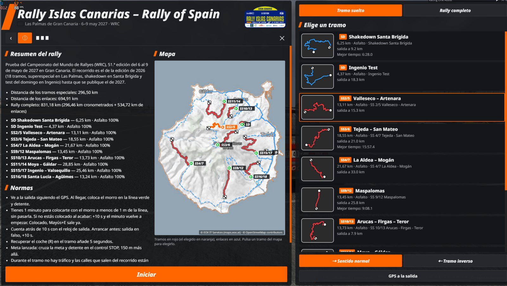
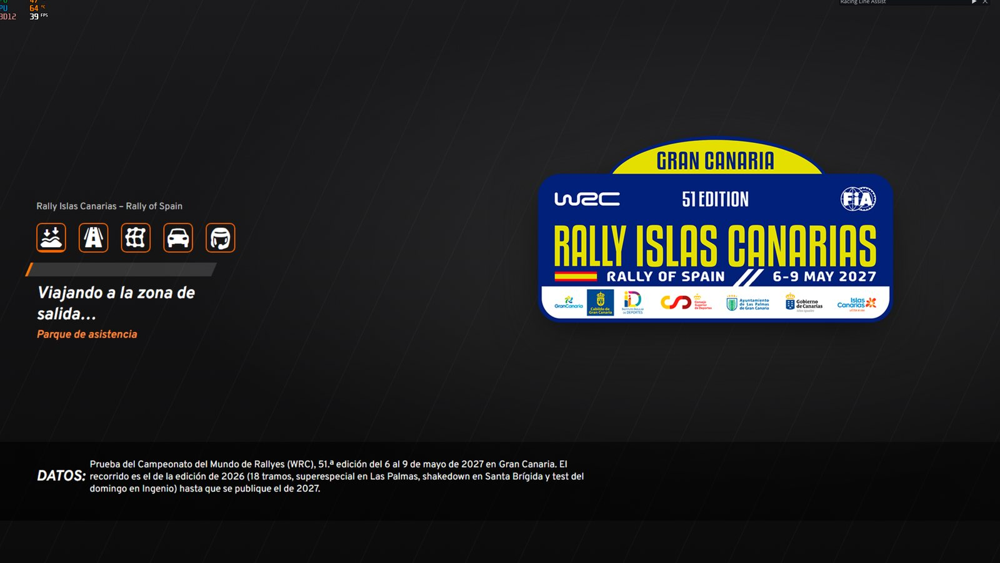
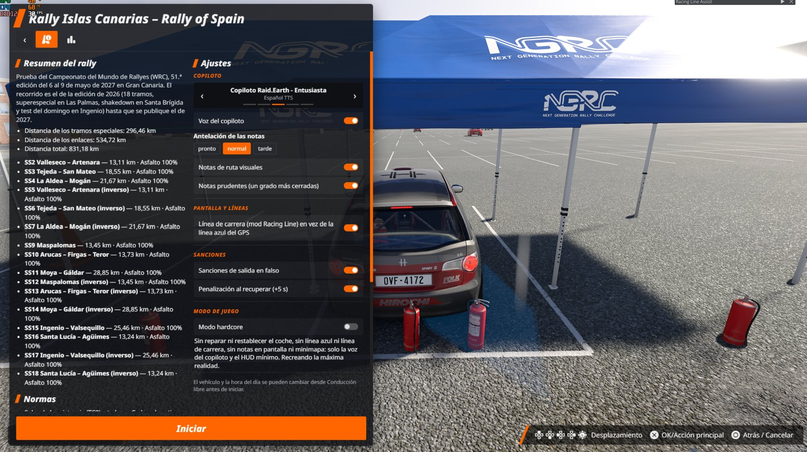

# Earth.Raid



[Español](README.md) · **English**

Real rallies, raids and the Dakar in **BeamNG.drive**, on the real-world map of **BeamNG.Earth**: the same stages, with their time controls, road sections and FIA-style signage, and a co-driver calling the pacenotes.

> In active development (v0.9). Testers and contributors are welcome: see [Contributing](#contributing).



## How it plays

### 1. Events, in the pause menu

Earth.Raid has its own tab in the pause menu (**Esc → Earth.Raid**), next to BeamNG.Earth and BeamMP. The list shows every event with its logo, place, championship and dates, how many stages it has, the timed kilometres and how far away you are. Routes are imported and settings changed from the same tab.



### 2. The event sheet

A summary of the rally, stage and road-section distances, the rules, and a map with the stages in red and the road sections in blue (click a stage on the map to pick it). On the right, every stage with its outline, length, surface, distance to the start and your best time.

- **Single stage or full rally.**
- **Normal or reverse direction**: the stage is dressed the same way in both.
- **Start** (travel with a loading screen) or **GPS to the start** to drive there.



### 3. Loading

When you start, restart or retire, the loading screen comes up first and everything else happens behind it: the car travels to the start area, BeamNG.Earth loads the terrain and the roads, the controls, the start and the crowd are set up, and the car is placed. Nothing moves in view, and the on-screen apps (minimap included) stay hidden until it is done.



### 4. The start screen

After loading, with the car stopped in the service bay or before the time control, you choose how to run:

- **Co-driver**: voice (the game's co-drivers and the Spanish co-driver that ships with the mod), how early the notes are called, visual notes and cautious notes (one grade tighter).
- **Screen and lines**: the Racing Line mod's line instead of the blue GPS line.
- **Penalties**: false start and vehicle recovery.
- **Hardcore mode**: no repairing or resetting the car, no lines, no on-screen notes or minimap; only the co-driver's voice and a minimal HUD.



### 5. The rally

The interface is the game's own rally mode, fed with the real event's data:

- **Event clock, your time and instructions**: which control to reach and between which minutes, with a 10 s penalty for every minute early or late.
- **Next control**: distance and the speed limit of the road section.
- **Time card**: due time, actual time and status for every control, the time of every stage, the total and the penalties.
- **Service park** with bays and TC0 at the exit; leave early with *Skip Clock* (Shift+E).

On the stage: time control with a stop, staging at the start line, countdown on the LED clock, timing with splits, flying finish and STOP control.

## What it does

- **Event catalogue** near where you are, with a configurable radius and filters by country, type, category, surface and status (running, upcoming, past).
- **Single stage or full rally**: road sections with their target time, time controls (TC) with a time card, penalties, service and results. One event at a time: retire from the running one before starting another.
- **Standard dressing on every stage**, the same in both directions (the reverse stage reuses the same objects):
  - **TC and STOP:** yellow warning, red board and a control post 150 m from the line, with gazebo, table, chair, LED clock to check in, night light and generator.
  - **Start and finish:** boards on both sides of the sensors, start lights with clock and countdown, spray-painted lines from edge to edge and end-of-zone board.
  - **Safety:** flying-finish warning at 100 m, 3-2-1 boards, radio and medical points. The ambulance is never in the way: if a side street leaves the road next to the point, that street is closed and the ambulance and the marshal's gazebo go inside it; otherwise it parks clear of the road (and if there is no room, it is not placed).
  - **Atmosphere:** advertising fences in a row (one after another, with a gap where there is a tree or a side street), spectators, sound, closed side streets at junctions and hay bales in escape roads.
  - **Fixed rule:** nothing on the road except cones on the centre line.
- **Routes fixed automatically**: zigzags from hand-drawn lines, badly georeferenced files (shifted off the road) and hooks at the beginning or the end that would leave the start facing backwards.
- **Co-driver**: visual and spoken pacenotes. Corners are measured again on the real road while you drive.
- **Physics objects near the car**: boards, cones and tapes fall or break when hit, as in the game's own rallies.
- **Route importer** from the menu (⤓ Import):
  - **Formats:** KMZ, KML, GPX, GeoJSON and OSM XML, with a logo, a source link and the event details.
  - **Automatic recognition:** stages, passes, road sections, controls, flying finish, STOP, radio points, jumps and chicanes, from the names organisers use on their maps.
- **A living service park**: a couple of rally cars parked in the bays next to yours, tarmac or gravel spec to match the rally.
- **Regional traffic**: on road sections and in free roam, the game's traffic has more cars from the part of the world you are in (in Europe, more German, French and Italian cars and EU-spec versions; in North America, more American ones; in Asia, more Japanese ones). It can be switched off in Settings.
- **No cheating**: switching vehicle during a stage cancels it.

## Requirements

- BeamNG.drive 0.40 or later.
- BeamNG.Earth, with its level loaded. Earth.Raid uses its add-on API: real position, GPS, teleport and places.

## Install

**From BeamNG.Earth (recommended):** pause menu → BeamNG.Earth → **Add-ons** → *Add from GitHub* → `RamiS-RP/Earth.Raid` → **Add**. It installs `earth_raid.zip` from the latest release.

**Channels:** **stable** (branch `main`, normal release) is what Add-ons installs and what players should use. **Beta** (branch `beta`, pre-release `vX.Y.Z-beta.N`) is for developers and testers: download it by hand from Releases.

**Included events** (in `earthRaid/packs/`):

| Event | Stages |
|---|---|
| 43 Rally Sierra Morena 2026 (ERC / S-CER) | 7 |
| Rally Islas Canarias – Rally of Spain (WRC) | 8, plus shakedown and test |
| 17º Rally de Asturias Histórico – Carlos Sainz Tribute | 6 |
| Rallye Cristian López 2026 | 4 |
| Trans Sierra Nevada | 16 sectors and routes |
| Rally de Ourense (S-CER) | test stage only |

Add more from the menu (⤓ Import).

**By hand:**
1. Download `earth_raid.zip` from [Releases](https://github.com/RamiS-RP/Earth.Raid/releases) (or build it with `tools/package.sh`).
2. Copy it **as it is, without unzipping**, into `<BeamNG user folder>/current/mods/`.
   - The zip must have `lua/`, `ui/`, `scripts/`… at its root. A zip with a folder inside (e.g. `raid-earth/lua/…`, the one GitHub's *Code → Download ZIP* gives you) **does not work**: the mod is listed but the menu never shows up.
3. Enter BeamNG.Earth and open **Esc → Earth.Raid**. For a shortcut, bind it in Options → Controls → "Earth.Raid: open the events menu".
4. Keep **a single copy**: if you installed from Add-ons (`earth_raid-1.zip`) and also by hand (`earth_raid.zip`), delete one. Two copies overwrite each other.

## Co-driver and voices

- **Inside the mod:** the Spanish **Copiloto en español (Piper)** (a neural voice generated with [Piper](https://github.com/rhasspy/piper), model `es_ES-davefx-medium`, from `tools/voicepack/es.json`). It ships inside the `earth_raid.zip` of every release (and is stored in the repository): nothing else to install. If you had the old `earth_raid_voice_es.zip`, you can delete it.
- **Real voice, also inside the mod:** **xpectro99**'s (Instagram [@xpectro99](https://www.instagram.com/xpectro99/)), from his *Rally Copilot Spanish* pack for Assetto Corsa ([Overtake](https://www.overtake.gg/downloads/csp-rallycopilot-spanish-español-voz-real.80899/)): 52 real recordings (experimental), used with the author's explicit permission; the notes it does not have yet are filled with the Piper voice (list in `tools/voicepack/xpectro99_fill.txt`) and will be replaced over time. Pick it as "Xpectro99". No separate download needed; if you also have the standalone voice mod there is no conflict (same files and paths). Credits in [CREDITS.md](CREDITS.md).
- **The game's own:** every BeamNG.drive co-driver (Alex Kihurani, dirtwheel, HighDef…) is also in the selector.
- **Other voices or languages:** translate `es.json` and run `tools/voicepack/make_voicepack.py` (Piper, Windows voices or espeak-ng). Any voicepack in the game's format shows up in the start screen → Co-driver.

## Recommended mods (for a better experience)

They are optional, but rallying feels much better with them. **Step by step:**

1. Open each link in the table (it is BeamNG's official website).
2. Click **Subscribe** (installs by itself) or **Download** (you get a `.zip`).
   - If you download it, copy that `.zip` **as it is, without unzipping it**, into your mods folder: `Documents\BeamNG.drive\<version>\mods` (or start the game → main menu → **Mods** → **Open mods folder**).
3. Start the game. **Earth.Raid turns on by itself** the recommended mods it finds downloaded (to stop that, switch off Earth.Raid → Settings → "Turn on downloaded recommended mods automatically").
4. To check: Earth.Raid → Settings → **Recommended mods**: each one says *enabled*, *downloaded* or *not installed*.

| Mod | What it does |
|---|---|
| [Racing Line Mod](https://www.beamng.com/resources/racing-line-mod.39806/) | Draws the ideal racing line **inside the stage** (from the start to the finish) instead of the blue GPS line. Outside the stage (to the time control and to the start line) the game's blue GPS line is always used. It can be switched off in the settings; without the mod you get the blue line. |
| [Hands on the Wheel](https://www.beamng.com/threads/hands-on-the-wheel-driver-immersion-mod-beta-0-5-0.111759/) | Puts the driver's hands on the steering wheel (a more real cockpit view). |
| [EnvyFFB](https://www.beamng.com/resources/envyffb-drift-force-feedback.40147/) | More realistic steering-wheel force feedback (if you play with a wheel). |
| [Realistic Headlights & Fogs V2](https://www.beamng.com/resources/realistic-headlights-fogs-v2.38672/) | Realistic headlights and fog lights: a must for night stages. |
| [Smoke Dust FX](https://www.beamng.com/resources/smoke-dust-fx.39628/) | Realistic smoke and dust, above all on gravel stages. |

**Language:** Earth.Raid follows the game's language (Spanish or English for now).

**Surfaces:** every stage is labelled with its FIA surface: tarmac, gravel, snow or mixed. When you import a route, pick it in the form or leave it on *Automatic* (it is read from the names: "tierra", "gravel", "snow"...). On gravel tracks and paths the game has no road for, the stage line itself counts as the road, so nothing is placed on it.

## Adding a rally

Menu → **⤓ Import** → **Open the folder**. Create one folder per event inside `settings/earthRaid/import/`:

```
settings/earthRaid/import/rally-islas-canarias/
  50RICv2.kmz              ← one or more route files (KMZ, KML, GPX, GeoJSON, OSM)
  Sunday_Test_-_Ingenio.kmz
  logo.png                 ← optional
  event.json               ← optional: the event details (also editable from the menu)
```

`event.json`:

```json
{
  "name": "Rally Islas Canarias – Rally of Spain",
  "dates": "2027-05-06/2027-05-09",
  "country": "es",
  "championship": "WRC",
  "organizer": "CD Todo Sport",
  "surface": "asphalt",
  "link": "https://rallyislascanarias.com/"
}
```

Whatever you leave out is worked out from the file: the name, the stages and their passes, the road sections and the service park. For a route of your own, draw the lines in Google My Maps and export the KML. Every line is a stage; lines called "Enlace…" or "A -> B" are road sections, and a point called "Asistencia" marks the service park.

**About the data:** routes belong to their organisers. Import only what you have the right to use (files the organiser publishes for download, or your own routes). The roads, buildings and places you see in the game come from BeamNG.Earth (OpenStreetMap, Overture, etc.) under their licences.

## Layout

| Folder | Contents |
|---|---|
| `lua/ge/extensions/earthRaid/` | The logic: `main` (menu, catalogue, import), `loader` (loading screen), `stage` (stage phases), `rally` (full rally), `servicepark` (service park), `dressing` (object layout), `props` and `phys` (game objects, static and with physics), `clean` (route clean-up), `pacenotes` (notes), `importer` (map formats), `startclock` (LED clock), `vhud` (the game's rally interface), `guard` (no cheating), `audit` (stage audit), `settings`… |
| `ui/` | The menu, the loading and start screens (Vue) and the HUD app. |
| `settings/ui_apps/layouts/` | The rally screens (stage, road section and hardcore). |
| `earthRaid/packs/` | The events that ship with the mod. Events each player imports go to `settings/earthRaid/packs/imported/`. |
| `art/` | Ambient sounds and fence prefabs. |
| `tools/catalog/` | Scripts to build event packs outside the game. |
| `tools/voicepack/` | The co-driver voice generator. |
| `docs/` | Dressing rules (in Spanish), the BeamMP plan and screenshots. |

## Roadmap

- **Automatic discovery of rallies worldwide** from public information: calendars, routes published by organisers and open data. This is where help is needed most.
- **Rally maps (rally-maps.com):** only with permission from its owner, which will be asked for first.
- **More events:** raids and the Dakar, with roadbook navigation, and regularity at an imposed average speed.
- **Online play:** persistent road closures on BeamMP.Earth ([plan](docs/plan-beammp.md), in Spanish).
- **More content:** stars and a local leaderboard, icons on the BeamNG.Earth map, real crowd recordings.

## Licence

Code under the [MIT](LICENSE) licence. The routes, names and logos of each rally belong to their organisers; import and distribute only what you have the right to use.

## Contributing

Issues and proposals are welcome in *Issues*. To send code:

1. Open an issue describing what you want to change.
2. Follow the [dressing rules](docs/normas.md) (in Spanish): they keep every stage at the same quality.
3. Work on the `beta` branch and test in the game. Check the log (`beamng.log`) for `earthRaid` warnings.
