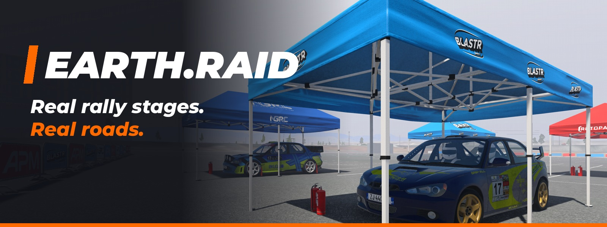
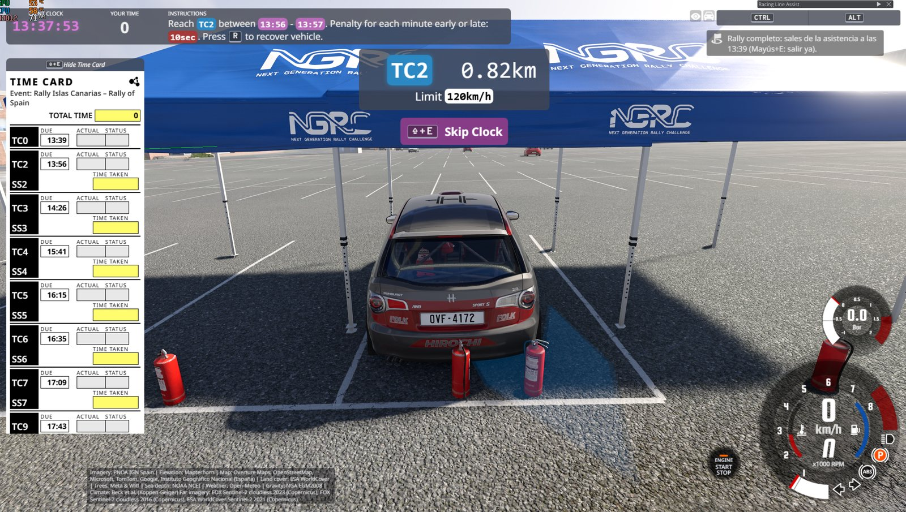
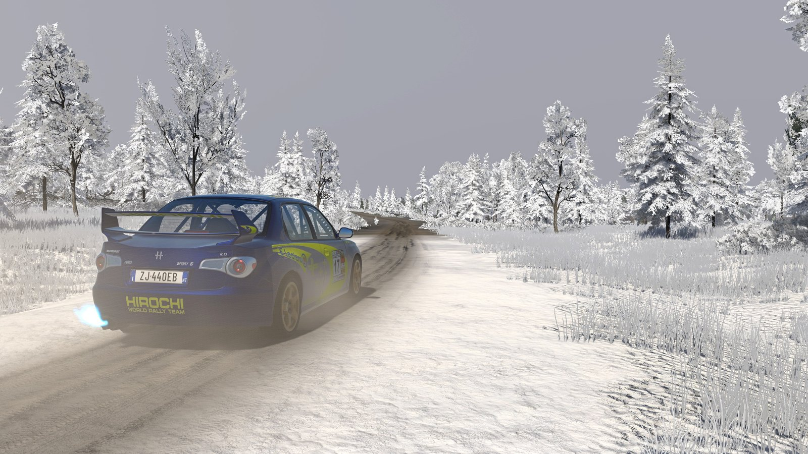
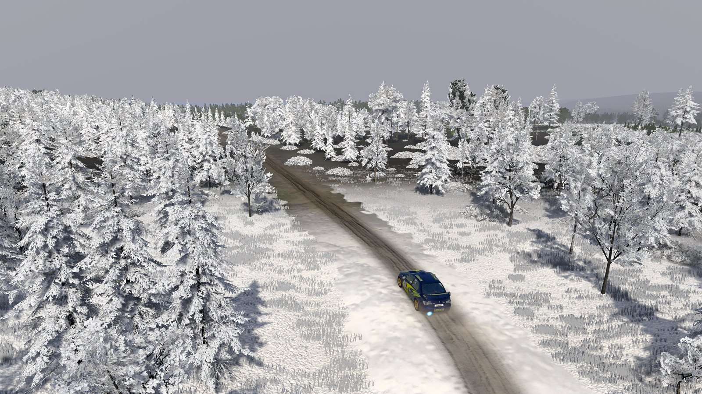
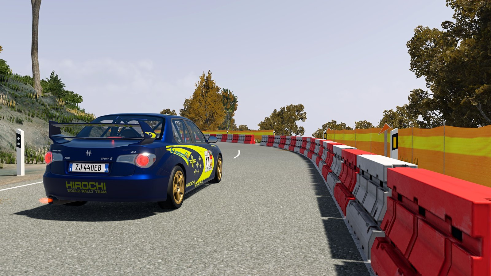
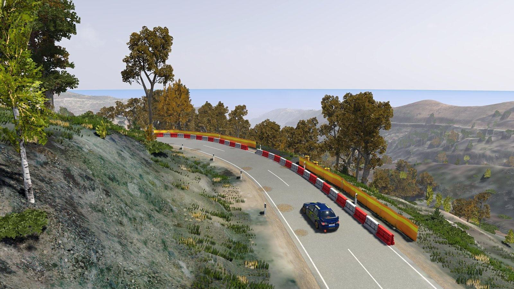
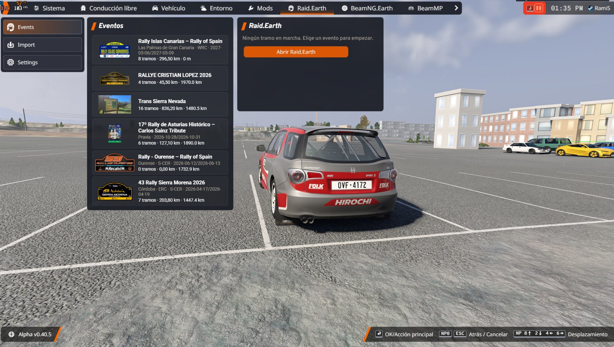
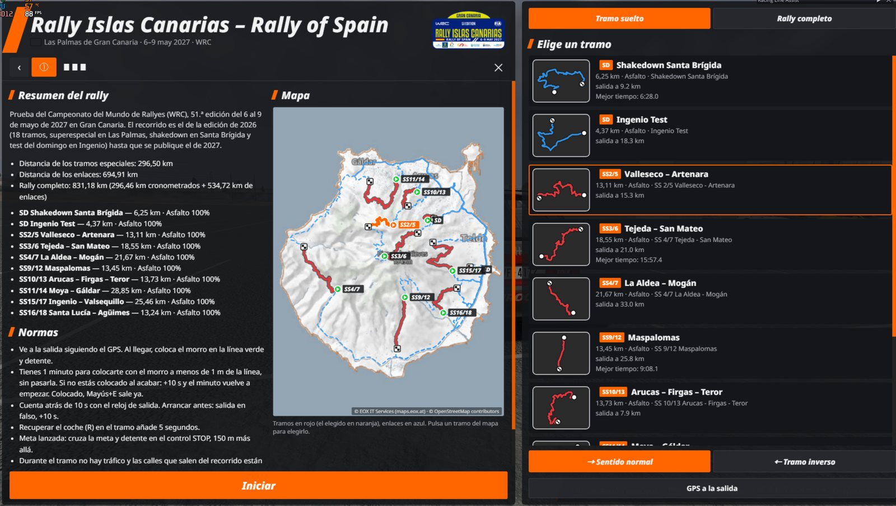
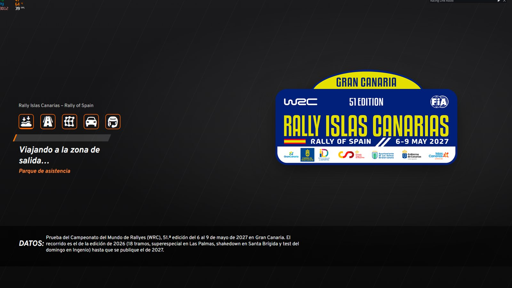
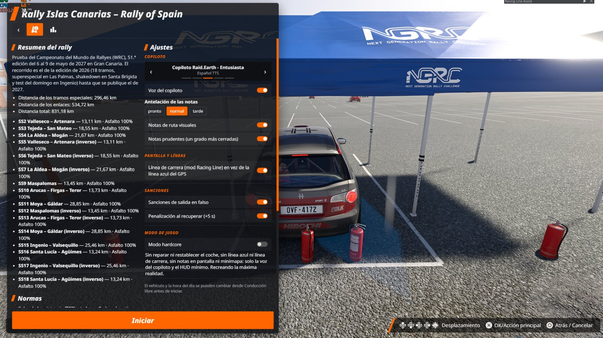

# Earth.Raid



**Español** · [English](README.en.md)

Rallies, raids y el Dakar de verdad en **BeamNG.drive**, sobre el mundo real de **BeamNG.Earth**: los mismos tramos, con sus controles horarios, sus enlaces y su señalización según el reglamento de la FIA, y un copiloto que canta las notas.

> En desarrollo activo (v0.9). Se buscan probadores y colaboradores: mira [Colaborar](#colaborar).



## Galería

| | |
|---|---|
|  |  |
|  |  |

## Así se juega

### 1. Los eventos, en el menú de pausa

Earth.Raid tiene su propia pestaña en el menú de pausa (**Esc → Earth.Raid**), junto a BeamNG.Earth y BeamMP. La lista enseña cada evento con su logo, lugar, campeonato y fechas, cuántos tramos tiene, los kilómetros cronometrados y a qué distancia estás. Desde ahí también se importan rutas y se cambian los ajustes.



### 2. La ficha del evento

Resumen del rally, distancias de tramos y enlaces, normas y un mapa con los tramos en rojo y los enlaces en azul (se puede elegir un tramo pulsándolo en el mapa). A la derecha, cada tramo con su dibujo, longitud, superficie, distancia a la salida y tu mejor tiempo.

- **Tramo suelto o rally completo.**
- **Sentido normal o tramo inverso**: el montaje es el mismo en los dos sentidos.
- **Iniciar** (viaje con pantalla de carga) o **GPS a la salida** para ir conduciendo.



### 3. La carga

Al iniciar, reiniciar o abandonar, primero aparece la pantalla de carga y, con ella puesta, pasa todo lo demás: el coche viaja a la zona de salida, BeamNG.Earth carga el terreno y las carreteras, se montan los controles, la salida y el público, y se coloca el coche. Nada se mueve a la vista y las apps de pantalla (minimapa incluido) quedan ocultas hasta que termina.



### 4. La pantalla de inicio

Tras la carga, con el coche parado en el box de asistencia o antes del control horario, eliges cómo quieres correr:

- **Copiloto**: voz (los copilotos del juego y el copiloto en español que trae el mod), antelación de las notas, notas visuales y notas prudentes (un grado más cerradas).
- **Pantalla y líneas**: la trazada del mod Racing Line en vez de la línea azul del GPS.
- **Sanciones**: salida en falso y penalización al recuperar el coche.
- **Modo hardcore**: sin reparar ni restablecer el coche, sin líneas, sin notas en pantalla ni minimapa; solo la voz del copiloto y el HUD mínimo.



### 5. El rally

La interfaz es la del modo rally del propio juego, alimentada con los datos del evento real:

- **Reloj del evento, tu tiempo e instrucciones**: a qué control tienes que llegar y entre qué minutos, con 10 s de penalización por cada minuto de adelanto o retraso.
- **Siguiente control**: distancia y límite de velocidad del enlace.
- **Carnet de ruta (Time Card)**: hora prevista, hora real y estado de cada control, tiempo de cada tramo, total y penalizaciones.
- **Parque de asistencia** con boxes y el TC0 a la salida; se puede salir antes con *Skip Clock* (Mayús+E).

En el tramo: control horario con parada, colocación en la línea de salida, cuenta atrás en el reloj LED, crono con parciales, meta lanzada y control STOP.

## Qué hace

- **Catálogo de eventos** cerca de donde estás, con radio configurable y filtros por país, tipo, categoría, superficie y estado (en curso, próximos, celebrados).
- **Tramo suelto o rally completo**: enlaces entre tramos con su tiempo asignado, controles horarios (TC) con carnet de ruta, penalizaciones, asistencia y resultados. Solo un evento a la vez: para empezar otro hay que abandonar el que está en marcha.
- **Montaje estándar en todos los tramos**, el mismo en los dos sentidos (el tramo inverso usa los mismos objetos):
  - **TC y STOP:** aviso amarillo, cartel rojo y puesto de control a 150 m de la línea, con carpa, mesa, silla, reloj LED para fichar, luz de noche y generador.
  - **Salida y meta:** carteles a ambos lados de los sensores, semáforo con reloj y cuenta atrás, líneas pintadas con spray de borde a borde y fin de zona.
  - **Zonas de seguridad:** aviso de meta lanzada a 100 m, tablillas 3-2-1, radio y punto médico. La ambulancia nunca estorba: si junto al punto sale una calle, esa calle se corta y dentro van la ambulancia y la carpa del comisario; si no, aparca fuera de la calzada (y si no cabe, no se pone).
  - **Ambiente:** vallas publicitarias en fila (una tras otra, con hueco donde hay un árbol o sale una calle), público, sonido, cortes de calles en los cruces y pacas en las escapatorias.
  - **Regla fija:** nada en la calzada salvo conos en el eje.
- **Trazados corregidos solos**: zigzags de líneas dibujadas a mano, archivos mal georreferenciados (desplazados de la carretera) y ganchos al principio o al final que dejarían la salida mirando al revés.
- **Copiloto**: notas visuales y de voz. Las curvas se vuelven a medir sobre la carretera real mientras conduces.
- **Objetos con física cerca del coche**: carteles, conos y cintas se caen o se rompen al tocarlos, como en los rallies del juego.
- **Importar rutas** desde el menú (⤓ Importar):
  - **Formatos:** KMZ, KML, GPX, GeoJSON y OSM XML, con su logo, un enlace a la fuente y la ficha del evento.
  - **Reconocimiento automático:** tramos, pasadas, enlaces, controles, meta lanzada, STOP, radios, saltos y chicanes, por los nombres que usan los mapas de los organizadores.
- **Parque de asistencia con vida**: un par de coches de rally aparcados en los boxes vecinos al tuyo, de asfalto o de tierra según el rally.
- **Tráfico de la zona**: en los enlaces y en conducción libre, el tráfico del juego lleva más coches de la parte del mundo donde estás (en Europa, más alemanes, franceses e italianos y versiones europeas; en Norteamérica, más americanos; en Asia, más japoneses). Se apaga en Ajustes.
- **Sin trampas**: cambiar de vehículo durante un tramo lo anula.

## Requisitos

- BeamNG.drive 0.40 o posterior.
- BeamNG.Earth, con su nivel cargado. Earth.Raid usa su API de complementos: posición real, GPS, teletransporte y lugares.

## Instalar

**Desde BeamNG.Earth (recomendado):** menú de pausa → BeamNG.Earth → **Add-ons** → *Add from GitHub* → `RamiS-RP/Earth.Raid` → **Add**. Se instala el `earth_raid.zip` de la última release.

**Versiones:** la **estable** (rama `main`, release normal) es la que instala Add-ons y la que se recomienda a los jugadores. La **beta** (rama `beta`, *pre-release* `vX.Y.Z-beta.N`) es para desarrolladores y probadores: descárgala a mano desde Releases.

**Eventos incluidos** (en `earthRaid/packs/`):

| Evento | Tramos |
|---|---|
| 43 Rally Sierra Morena 2026 (ERC / S-CER) | 7 |
| Rally Islas Canarias – Rally of Spain (WRC) | 8, más shakedown y test |
| 17º Rally de Asturias Histórico – Carlos Sainz Tribute | 6 |
| Rallye Cristian López 2026 | 4 |
| Trans Sierra Nevada | 16 sectores y rutas |
| Rally de Ourense (S-CER) | solo el test |

Puedes añadir más desde el menú (⤓ Importar).

**A mano:**
1. Descarga `earth_raid.zip` de [Releases](https://github.com/RamiS-RP/Earth.Raid/releases) (o créalo con `tools/package.sh`).
2. Cópialo **tal cual, sin descomprimir**, a `<carpeta de usuario de BeamNG>/current/mods/`.
   - El zip debe tener `lua/`, `ui/`, `scripts/`… en su raíz. Un zip con una carpeta dentro (p. ej. `raid-earth/lua/…`, el que da *Code → Download ZIP* de GitHub) **no funciona**: el mod sale en la lista pero no aparece el menú.
3. Entra en BeamNG.Earth y abre **Esc → Earth.Raid**. Si quieres un atajo, asígnalo en Opciones → Controles → «Earth.Raid: open the events menu».
4. Ten **una sola copia**: si instalaste desde Add-ons (`earth_raid-1.zip`) y además a mano (`earth_raid.zip`), borra una. Dos copias a la vez se pisan.

## Copiloto y voces

- **Dentro del mod:** el **Copiloto en español (Piper)** (voz neuronal generada con [Piper](https://github.com/rhasspy/piper), modelo `es_ES-davefx-medium`, a partir de `tools/voicepack/es.json`). Va en el propio `earth_raid.zip` de cada release (y guardada en el repositorio): no hay que instalar nada más. Si tenías el antiguo `earth_raid_voice_es.zip`, puedes borrarlo.
- **Voz real, también dentro del mod:** la de **xpectro99** (Instagram [@xpectro99](https://www.instagram.com/xpectro99/)), de su pack *Rally Copilot Spanish* para Assetto Corsa ([Overtake](https://www.overtake.gg/downloads/csp-rallycopilot-spanish-español-voz-real.80899/)): 52 grabaciones reales (experimental), usadas con permiso explícito del autor; solo suenan sus notas reales, sin mezclarla con otra voz: las que aún no tiene no se dicen, y se irán añadiendo. Elígela como «Xpectro99». No hace falta descargarla aparte; si ya tienes el mod de voz independiente, no hay conflicto (mismos archivos y rutas). Créditos en [CREDITS.md](CREDITS.md).
- **Los del juego:** cualquier copiloto de BeamNG.drive (Alex Kihurani, dirtwheel, HighDef…) aparece también en el selector.
- **Otras voces o idiomas:** traduce `es.json` y ejecuta `tools/voicepack/make_voicepack.py` (Piper, voces de Windows o espeak-ng). Cualquier voicepack con el formato del juego aparece en la pantalla de inicio → Copiloto.

## Mods recomendados (para una mejor experiencia)

No son obligatorios, pero con ellos el rally se vive mucho mejor. **Paso a paso:**

1. Entra en cada enlace de la tabla (es la web oficial de BeamNG).
2. Pulsa **Subscribe** (se instala solo) o **Download** (se descarga un `.zip`).
   - Si lo descargas, copia ese `.zip` **tal cual, sin descomprimir**, a tu carpeta de mods: `Documentos\BeamNG.drive\<versión>\mods` (o abre el juego → menú principal → **Mods** → **Abrir carpeta de mods**).
3. Abre el juego. **Earth.Raid activa solo** los mods recomendados que encuentre descargados (si no quieres, apágalo en Earth.Raid → Ajustes → «Activar solos los mods recomendados descargados»).
4. Para comprobarlo: Earth.Raid → Ajustes → **Mods recomendados**: cada uno dice *activado*, *descargado* o *no instalado*.

| Mod | Para qué sirve |
|---|---|
| [Racing Line Mod](https://www.beamng.com/resources/racing-line-mod.39806/) | Dibuja la trazada ideal **dentro del tramo** (de la salida a la meta), en lugar de la línea azul del GPS. Fuera del tramo (hacia el control horario y hacia la salida) siempre se usa la línea azul del GPS del juego. Se puede apagar en los ajustes; si no lo tienes, verás la línea azul. |
| [Hands on the Wheel](https://www.beamng.com/threads/hands-on-the-wheel-driver-immersion-mod-beta-0-5-0.111759/) | Pone las manos del piloto en el volante (vista interior más real). |
| [EnvyFFB](https://www.beamng.com/resources/envyffb-drift-force-feedback.40147/) | Force feedback del volante más realista (si juegas con volante). |
| [Realistic Headlights & Fogs V2](https://www.beamng.com/resources/realistic-headlights-fogs-v2.38672/) | Faros y antinieblas realistas: imprescindible en tramos de noche. |
| [Smoke Dust FX](https://www.beamng.com/resources/smoke-dust-fx.39628/) | Humo y polvo realistas, sobre todo en tramos de tierra. |

**Idioma:** Earth.Raid usa el idioma del juego (por ahora español o inglés).

**Superficies:** cada tramo lleva su superficie FIA: asfalto, tierra (grava), nieve o mixto. Al importar una ruta, elígela en el formulario o déjala en *Automática* (se lee de los nombres: «tierra», «grava», «nieve»...). En pistas y caminos de tierra que el juego no tiene como carretera, el propio trazado del tramo cuenta como calzada, así que no se pone nada encima.

## Añadir un rally

Menú → **⤓ Importar** → **Abrir la carpeta**. Crea una carpeta por evento dentro de `settings/earthRaid/import/`:

```
settings/earthRaid/import/rally-islas-canarias/
  50RICv2.kmz              ← uno o varios archivos de ruta (KMZ, KML, GPX, GeoJSON, OSM)
  Sunday_Test_-_Ingenio.kmz
  logo.png                 ← opcional
  event.json               ← opcional: la ficha (también se edita desde el menú)
```

`event.json`:

```json
{
  "name": "Rally Islas Canarias – Rally of Spain",
  "dates": "2027-05-06/2027-05-09",
  "country": "es",
  "championship": "WRC",
  "organizer": "CD Todo Sport",
  "surface": "asphalt",
  "link": "https://rallyislascanarias.com/"
}
```

Lo que no rellenes se deduce del archivo: el nombre, los tramos y sus pasadas, los enlaces y el parque de asistencia. Para una ruta propia basta con dibujar las líneas en Google My Maps y exportar el KML. Cada línea es un tramo; las que se llaman «Enlace…» o «A -> B» son enlaces, y un punto llamado «Asistencia» marca el parque.

**Sobre los datos:** los recorridos pertenecen a sus organizadores. Importa solo lo que tengas derecho a usar (archivos publicados por el organizador para descargar, o rutas propias). Las carreteras, edificios y lugares que se ven en el juego vienen de BeamNG.Earth (OpenStreetMap, Overture, etc.) con sus licencias.

## Estructura

| Carpeta | Contenido |
|---|---|
| `lua/ge/extensions/earthRaid/` | La lógica: `main` (menú, catálogo, importación), `loader` (pantalla de carga), `stage` (fases del tramo), `rally` (rally completo), `servicepark` (parque de asistencia), `dressing` (montaje de objetos), `props` y `phys` (objetos del juego, con y sin física), `clean` (limpieza de trazados), `pacenotes` (notas), `importer` (formatos de mapas), `startclock` (reloj LED), `vhud` (interfaz de rally del juego), `guard` (sin trampas), `audit` (auditoría de tramos), `settings`… |
| `ui/` | El menú, la pantalla de carga y la de inicio (Vue) y la app del HUD. |
| `settings/ui_apps/layouts/` | Las pantallas de rally (tramo, enlace y hardcore). |
| `earthRaid/packs/` | Los eventos que trae el mod. Los que importa cada jugador van a `settings/earthRaid/packs/imported/`. |
| `art/` | Sonidos de ambiente y prefabs de vallas. |
| `tools/catalog/` | Scripts para construir paquetes de eventos fuera del juego. |
| `tools/voicepack/` | El generador de voces de copiloto. |
| `docs/` | Normas del montaje, plan de BeamMP y capturas. |

## Hoja de ruta

- **Búsqueda automática de rallies de todo el mundo** con la información pública disponible: calendarios, recorridos publicados por los organizadores y datos abiertos. Es la parte en la que más ayuda hace falta.
- **Mapas de rallies (rally-maps.com):** solo con el permiso de su responsable, que se pedirá antes de nada.
- **Más eventos:** raids y el Dakar, con navegación por roadbook, y regularidad a velocidad media impuesta.
- **Juego en línea:** cortes de carretera persistentes en BeamMP.Earth ([plan](docs/plan-beammp.md)).
- **Más contenido:** estrellas y clasificación local, iconos en el mapa de BeamNG.Earth, grabaciones reales de público.

## Licencia

Código bajo licencia [MIT](LICENSE). Los recorridos, nombres y logos de cada rally pertenecen a sus organizadores; importa y distribuye solo lo que tengas derecho a usar.

## Colaborar

Las incidencias y las propuestas son bienvenidas en *Issues*. Para enviar código:

1. Abre una incidencia contando qué quieres cambiar.
2. Sigue las [normas del montaje](docs/normas.md): son las que mantienen todos los tramos con la misma calidad.
3. Trabaja sobre la rama `beta` y prueba en el juego. Revisa el registro (`beamng.log`) buscando avisos de `earthRaid`.
